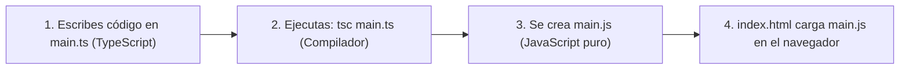

# 📘 Guía de Estudio — Capítulo 1: Empezando con TypeScript (Getting Started)

En este primer capítulo ([`LIBRO-REACT-2023.md`](../LIBRO-REACT-2023.md#L26-L79)) aprendemos qué es **TypeScript**, por qué existe y cómo convertir código TypeScript (`.ts`) en código JavaScript (`.js`) que el navegador pueda ejecutar.

---

## 1. ¿Qué es TypeScript en palabras simples?

- **JavaScript** es muy permisivo: te deja sumar un número con un texto (`10 + "20" = "1020"`) y recién te enteras del error cuando la página ya está funcionando.
- **TypeScript** es **JavaScript con tipos** (creado por Microsoft). Revisa tu código **antes de ejecutarlo** y te avisa inmediatamente en el editor si te equivocas de tipo de dato.
- **Regla de oro:** Los navegadores (Chrome, Firefox, Edge) **no entienden archivos `.ts`**. Solo entienden `.js`. Por eso usamos el compilador `tsc` (TypeScript Compiler) para traducir `.ts` a `.js`.



---

## 2. Los 3 Pasos del Capítulo 1

### Paso 1: Instalar TypeScript
Se instala una sola vez en tu computadora con `npm`:

```bash
npm i -g typescript
```

Para comprobar que quedó instalado:

```bash
tsc -v
```

### Paso 2: Crear el archivo HTML (`index.html`)
El archivo HTML **siempre conecta el archivo `.js` resultante**, nunca el `.ts`:

```html
<!-- OJO: Conectamos main.js, NO main.ts -->
<script src="main.js"></script>
```

### Paso 3: Escribir `main.ts` y compilarlo
Escribimos nuestro código en [`main.ts`](./main.ts) y en la terminal ejecutamos:

```bash
tsc main.ts
```

Eso genera automáticamente `main.js`.

---

## 3. Archivos de Práctica en esta Carpeta (`chapter01/`)

| Archivo | Descripción |
| :--- | :--- |
| [`index.html`](./index.html) | Página HTML básica que carga `main.js`. |
| [`main.ts`](./main.ts) | Primer programa en TypeScript explicado paso a paso. |
| [`ejercicios.ts`](./ejercicios.ts) | 3 ejercicios sencillos resueltos para practicar cómo funciona TypeScript. |
| [`tsconfig.json`](./tsconfig.json) | Configuración para que TypeScript revise los tipos de esta carpeta. |

---

## 4. Cómo Probar los Ejercicios

En la terminal, dentro de `chapter01/`:

```bash
# 1. Compilar los archivos .ts a .js
npx tsc

# 2. Ejecutar los ejercicios con Node
node ejercicios.js
```
