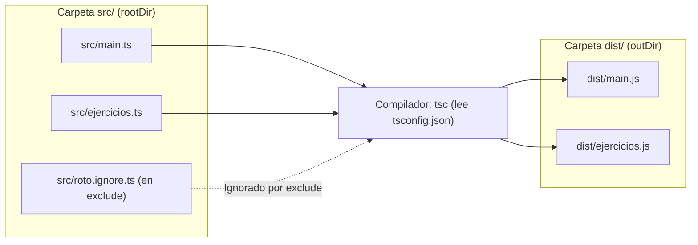

# 📘 Guía de Estudio — Capítulo 3: El Compilador de TypeScript (`tsc` y `tsconfig.json`)

En el **Capítulo 3** ([`LIBRO-REACT-2023.md`](../LIBRO-REACT-2023.md#L423-L489)) dejamos de compilar archivo por archivo a mano y aprendemos a **automatizar y ordenar todo el proyecto** usando `tsconfig.json`.

---

## 1. Los 4 Conceptos del Capítulo 3

| # | Comando / Configuración | ¿Qué hace en palabras simples? |
| :-: | :--- | :--- |
| **1** | **`tsc main.ts -w`** *(Watch Mode)* | Se queda "vigilando" el archivo. Cada vez que guardas (`Ctrl + S`), lo traduce a `.js` automáticamente sin que tengas que volver a escribir el comando. |
| **2** | **`tsc --init`** | Crea el archivo de configuración **`tsconfig.json`** en la carpeta raíz. A partir de ese momento, basta con escribir solo **`tsc`** (o **`tsc -w`**) para compilar **todos** los archivos del proyecto de una vez. |
| **3** | **`"include"` y `"exclude"`** | Le dicen a TypeScript **qué archivos sí quieres compilar** (`include`) y **cuáles debe ignorar** (`exclude`, como `node_modules` o archivos de prueba con errores). |
| **4** | **`"rootDir"` y `"outDir"`** | Ordena tu proyecto en dos carpetas separadas: escribes tu código `.ts` limpio en **`./src`** (`rootDir`) y TypeScript guarda los `.js` generados en **`./dist`** (`outDir`). |

---

## 2. ¿Cómo fluye un proyecto bien organizado (`src` $\rightarrow$ `dist`)?

En los Capítulos 1 y 2, los archivos `.ts` y `.js` quedaban mezclados en la misma carpeta. En el Capítulo 3 los separamos así:



---

## 3. Así luce el `tsconfig.json` explicado línea por línea

> ⚠️ **Nota:** los comentarios `//` de este ejemplo son didácticos. Un `tsconfig.json` real no admite comentarios; el archivo [`tsconfig.json`](./tsconfig.json) de esta carpeta es el que debes usar.

```json
{
  "compilerOptions": {
    "target": "ES2022",
    "module": "ESNext",
    "rootDir": "./src",   // 1. De dónde lee tus archivos .ts
    "outDir": "./dist",   // 2. Dónde deposita los archivos .js listos
    "strict": true
  },
  "include": [
    "src/**/*.ts"         // 3. Compila todos los .ts dentro de src/
  ],
  "exclude": [
    "node_modules",       // 4. Nunca compiles librerías externas
    "src/roto.ignore.ts"  // 5. Ignora este archivo aunque tenga errores
  ]
}
```

---

## 4. Archivos de Práctica en esta Carpeta (`chapter03/`)

| Archivo | ¿Para qué sirve? |
| :--- | :--- |
| [`tsconfig.json`](./tsconfig.json) | Configurado con `rootDir: "./src"`, `outDir: "./dist"`, `include` y `exclude`. |
| [`index.html`](./index.html) | Carga `dist/main.js` y `dist/ejercicios.js` (nota que ahora busca dentro de `dist/`). |
| [`src/main.ts`](./src/main.ts) | Ejemplo del libro (*Listing 3-1*) dentro de la carpeta `src/`. |
| [`src/ejercicios.ts`](./src/ejercicios.ts) | 3 ejercicios prácticos sobre configuración y compilación de múltiples archivos. |
| [`src/roto.ignore.ts`](./src/roto.ignore.ts) | Archivo con un error de tipo a propósito que **no rompe la compilación** porque está en `"exclude"`. |

---

## 5. Cómo Probarlo en la Terminal

Dentro de `chapter03/`:

```bash
# 1. Compila todo src/ hacia dist/ (ignorando roto.ignore.ts)
npx tsc

# 2. Ejecuta los archivos compilados desde dist/
node dist/main.js
node dist/ejercicios.js
```
