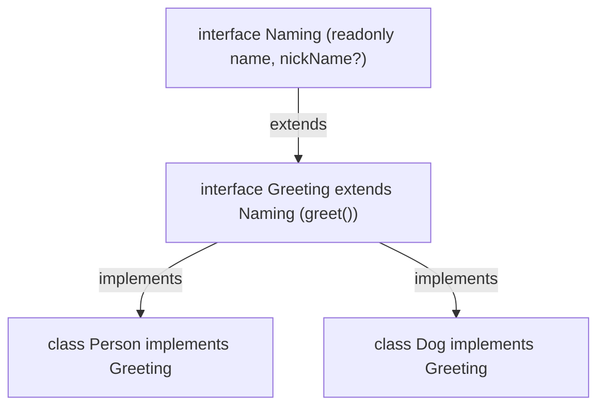

# 📘 Guía de Estudio — Capítulo 4: Clases e Interfaces (Classes and Interfaces)

El **Capítulo 4** ([`LIBRO-REACT-2023.md`](../LIBRO-REACT-2023.md#L490-L954)) explica cómo funciona la Programación Orientada a Objetos (POO) en TypeScript. **Todo lo que viste en el proyecto Drag-and-Drop de los Capítulos 8 y 9 nace aquí.**

---

## 1. Tabla Fácil de Modificadores en Clases (`public`, `private`, `protected`, `readonly`, `static`)

Imagina una clase como una **Casa**:

| Palabra clave | ¿Quién puede usarla? | Analogía de la Casa |
| :--- | :--- | :--- |
| **`public`** *(por defecto)* | **Cualquiera** (adentro de la clase, clases hijas y desde afuera). | El timbre de la calle: cualquiera puede tocarlo. |
| **`private`** | **Solo dentro de la misma clase** donde se creó. | Tu diario personal bajo llave: ni tus hijos ni nadie afuera puede tocarlo directo. |
| **`protected`** | **La clase madre y sus clases hijas (`extends`)**, pero nadie desde afuera. | La llave de la cocina familiar: la usan los padres y los hijos, pero no los extraños. |
| **`readonly`** | Se puede leer, pero **nunca modificar** después de crearse. | Tu fecha de nacimiento en el DNI: todos pueden leerla, nadie puede cambiarla. |
| **`static`** | Pertenece a la **Clase misma**, sin necesidad de hacer `new Clase()`. | El año actual (`OyoRoom.currentYear`): no necesitas alquilar un cuarto para saber en qué año estamos. |

---

## 2. Los 6 Conceptos Clave de Clases en TypeScript

### 2.1. El Atajo del Constructor (Constructor Shorthand)
En lugar de declarar variables arriba y luego escribir `this.room = room`, TypeScript hace las dos cosas en una sola línea poniendo `public` o `private` dentro de los paréntesis del `constructor`:

```typescript
// ❌ Forma larga:
class CuartoLargo {
    public room: string;
    constructor(room: string) {
        this.room = room;
    }
}

// ✅ Forma corta de TypeScript (exactamente igual):
class CuartoCorto {
    constructor(public room: string) {}
}
```

---

### 2.2. Herencia (`extends` y `super`)
Una clase hija hereda todo lo de su clase madre usando `extends` y llamando a `super()` en su constructor:

```typescript
class OyoRoom extends Room {
    constructor(room: string, private roomRent: number) {
        super(room); // Envía 'room' al constructor de la madre (Room)
    }
}
```

---

### 2.3. Getters (`get`) y Setters (`set`)
Sirven para leer o guardar una propiedad `private` como si fuera una variable normal (sin usar paréntesis `()`):

```typescript
shekar.newReport = 'Reporte Anual'; // Llama al 'set newReport(valor)'
console.log(shekar.allReports);     // Llama al 'get allReports()' (¡sin paréntesis!)
```

---

### 2.4. Clases Abstractas (`abstract class`)
Una clase abstracta es un **molde incompleto**:
1. **No puedes hacer `new Room()`** directamente.
2. Puede tener métodos `abstract` vacíos que **obligan** a las clases hijas a escribir su propia versión:

```typescript
abstract class Room {
    constructor(public room: string) {}
    // Obliga a que cada hijo (OyoRoom, TreboHotel) limpie a su manera:
    abstract cleanRoom(soap: string): void;
}
```

---

### 2.5. Patrón Singleton (`private constructor` + `static getInstance`)
¿Recuerdas `prjState = State.getInstance()` del Capítulo 8? Aquí nace ese patrón:
- Al poner **`private constructor`**, nadie puede hacer `new TreboHotel()` desde afuera.
- Solo se puede pedir la instancia con **`TreboHotel.getInstance()`**, garantizando que exista **un único hotel en memoria**.

---

### 2.6. Interfaces con Clases (`implements` y `extends`)
Una `interface` funciona como un **contrato** para una clase:



- `interface Greeting extends Naming`: Una interfaz puede heredar de otra interfaz.
- `class Person implements Greeting`: Obliga a que `Person` tenga `name` y el método `greet()`.
- `nickName?: string`: Como tiene `?`, `Dog` la usa pero `Person` no está obligado a tenerla.

---

### 2.7. Erratas corregidas del libro (Capítulo 4)

El código de esta carpeta corrige estos errores del texto original:

| Listing | Error en el libro | Corrección aplicada |
| :---: | :--- | :--- |
| **4-5** | `` console.log(`${this.room}`s room rent is ...`); `` (template string cerrado antes de tiempo) | `` `${this.room}'s room rent is $${this.roomRent}` `` |
| **4-10** | El mismo template string roto en `cleanRoom` de `OyoRoom` | `` `${this.room}'s Oyo Room cleaned with ${soap}` `` |
| **4-11** | El mismo template string roto en `cleanRoom` de `TreboHotel` | `` `${this.room}'s Trebo Room cleaned with ${soap}` `` |
| **4-7 / 4-8** | `const kapil = new OyoRoom('Shobha', 1000);` (copia/pega) | No se crean objetos `shobha`/`kapil`; solo se prueba `shekar` |
| **4-1** | `nabendu.family` accede a una propiedad `private` y rompe la compilación | Se explica el modificador, pero no se ejecuta el acceso inválido |

Además, los archivos son una **versión consolidada**: `classDemo.ts` no repite la evolución `CreateRoom` → `Room` de los Listings 4-1 a 4-4; empieza directamente con la clase abstracta final (4-10) y sus hijas. `interfaceDemo.ts` muestra la versión final de `Naming`/`Greeting` (4-15 y 4-16).

---

## 3. Archivos de Práctica en esta Carpeta (`chapter04/`)

| Archivo | ¿Qué contiene? |
| :--- | :--- |
| [`classDemo.ts`](./classDemo.ts) | Versión consolidada de Clases (*Listings 4-4 a 4-11*: `Room`, `OyoRoom`, `TreboHotel`, getter/setter y singleton). |
| [`interfaceDemo.ts`](./interfaceDemo.ts) | Versión consolidada de Interfaces (*Listings 4-15 y 4-16*: `Naming`, `Greeting`, `Person`, `Dog`). |
| [`ejercicios.ts`](./ejercicios.ts) | **5 ejercicios prácticos sencillos** para dominar Clases e Interfaces paso a paso. |
| [`tsconfig.json`](./tsconfig.json) | Configuración del compilador para esta carpeta. |

---

## 4. Cómo Ejecutar los Ejemplos y Ejercicios

En la terminal, dentro de `chapter04/`:

```bash
# 1. Compilar a JavaScript
npx tsc

# 2. Ver los ejemplos del libro
node classDemo.js
node interfaceDemo.js

# 3. Ver los 5 ejercicios resueltos
node ejercicios.js
```
