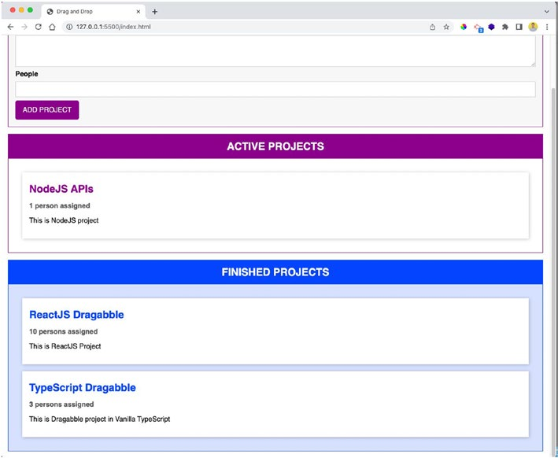
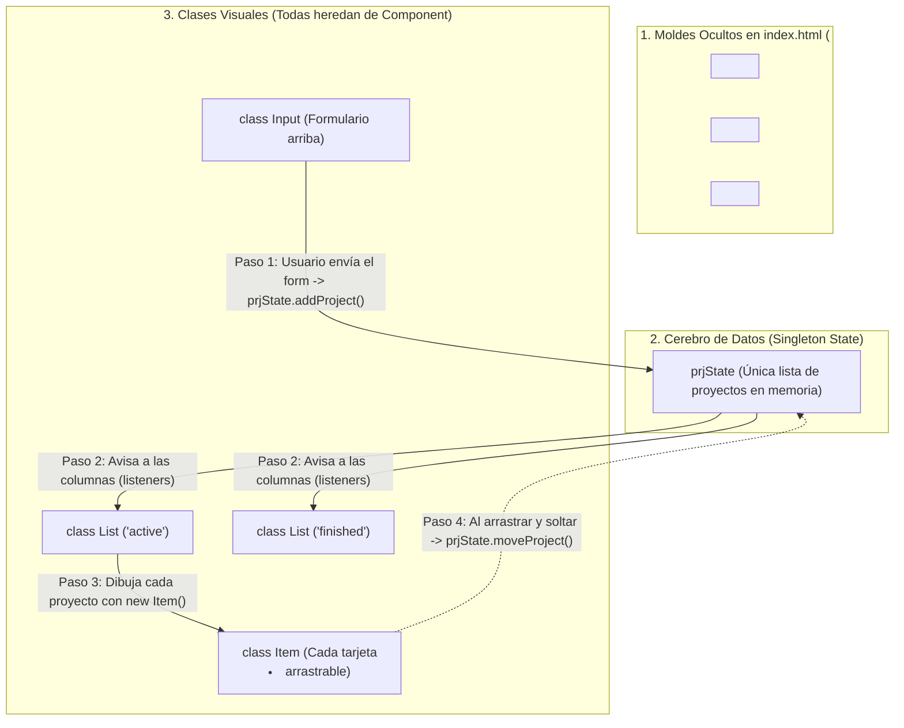

# 📘 Guía de Estudio sin Confusión — Capítulo 8: Proyecto Drag-and-Drop en TypeScript

Esta guía desglosa el **Capítulo 8** del libro ([`LIBRO-REACT-2023.md`](../LIBRO-REACT-2023.md#L1752-L2612)) de principio a fin, explicando **por qué el texto original resulta confuso** y **cómo funciona realmente cada pieza de TypeScript** que construye el proyecto.



---

## 1. ¿Por qué confunde tanto leer el Capítulo 8 del libro?

Si al leer el capítulo sentiste que te perdías, **no es culpa tuya**. El autor del libro comete 4 errores didácticos al explicar todo dentro de un único archivo (`src/index.ts`):

1. **Cambia el nombre de una clase a mitad del capítulo:**
   - Al principio (*Listings 8-4 y 8-5*), el autor crea una clase llamada `class Project` para controlar el **formulario HTML**.
   - De repente, en el *Listing 8-7*, le cambia el nombre a `class Input` sin avisar claramente.
   - Y más adelante (*Listing 8-11*), vuelve a crear otra `class Project`, ¡pero esta vez para representar los **datos de un proyecto** (`id`, `title`, `description`, `people`, `status`)!
2. **Escribe código y luego lo borra para reescribirlo:**
   - Primero escribe las clases `Input` y `List` copiando y pegando la lógica de seleccionar `<template>` del DOM.
   - A mitad del capítulo (*Listing 8-15*), borra los constructores que acababa de explicar y los reemplaza por herencia con una clase abstracta `abstract class Component<T, U>`.
3. **Usa la etiqueta `<template>` de HTML5 en lugar de componentes modernos:**
   - A diferencia de React (donde escribes JSX directo), aquí el HTML tiene etiquetas `<template>` que **son invisibles** en la página hasta que TypeScript las "clona" en memoria con `document.importNode()` y las inyecta dentro de `<div id="app"></div>`.
4. **Mezcla dos mundos distintos al mismo tiempo:**
   - Mezcla **TypeScript puro (POO y Tipos)** con **APIs nativas del navegador** (`insertAdjacentElement`, `DragEvent`, `dataTransfer`).

---

## 2. El Mapa Mental Simple: ¿Qué hace realmente la aplicación?

Olvida por un momento el desorden del libro. La aplicación es simplemente un **mini-tablero estilo Trello con 1 formulario arriba y 2 columnas abajo** (*ACTIVE PROJECTS* en morado y *FINISHED PROJECTS* en azul):



---

## 3. Los 6 Conceptos de TypeScript que Aprenderás Aquí

El verdadero propósito de este capítulo es practicar **Programación Orientada a Objetos (POO) y Tipos Avanzados en TypeScript**. Aquí tienes el resumen de qué herramienta de TypeScript se usa y para qué sirve cada una:

| # | Concepto de TypeScript | Dónde aparece en el código | ¿Para qué sirve en palabras simples? |
| :-: | :--- | :--- | :--- |
| **1** | **Tupla** (`[string, string, number]`) | Método `configure()` de `Input` | Para guardar los 3 datos del formulario (`[título, descripción, personas]`) asegurando que el 1° y 2° sean textos y el 3° sea un número. |
| **2** | **Enum** (`enum ProjectStatus`) | `ProjectStatus.Active` / `Finished` | Para no equivocarnos escribiendo textos libres. Un proyecto solo puede tener estatus `Active` (`0`) o `Finished` (`1`). |
| **3** | **Atajos de Constructor** (`public id: string`) | `class Project` | En vez de declarar propiedades arriba y hacer `this.id = id` dentro del `constructor`, TypeScript lo hace automático poniendo `public` delante de cada parámetro. |
| **4** | **Singleton** (`private constructor` + `static getInstance`) | `class State` | Garantiza que en toda la aplicación **solo exista una única caja de datos (`prjState`)**. Nadie puede hacer `new State()` por error desde afuera. |
| **5** | **Clase Abstracta + Genéricos** (`abstract class Component<T, U>`) | `Component<T, U>` | Es una "clase madre" que hace el trabajo sucio de clonar el `<template>` del HTML y pegarlo en `<div id="app">`. `Input`, `List` e `Item` heredan de ella con `extends` para no repetir código. |
| **6** | **Interfaces como Contratos** (`implements Draggable`, `DragTarget`) | `Item` y `List` | Obliga a que `Item` tenga los métodos para **empezar/terminar de arrastrar** y que `List` tenga los métodos para **recibir lo que sueltas**. |

---

## 4. Explicación Paso a Paso de los 4 Bloques del Código

Para entender el código final sin enredos, imagínalo dividido en **4 bloques lógicos**.

---

### Bloque 1: Los Moldes HTML (`index.html`)

En el archivo `index.html` ponemos tres etiquetas `<template>` y un `<div id="app"></div>` vacío:

```html
<!-- 1. Molde para el formulario -->
<template id="project">
  <form>
    <div class="form-control">
      <label for="title">Title</label>
      <input type="text" id="title" />
    </div>
    <div class="form-control">
      <label for="description">Description</label>
      <textarea id="description" rows="3"></textarea>
    </div>
    <div class="form-control">
      <label for="people">People</label>
      <input type="number" id="people" step="1" min="0" max="10" />
    </div>
    <button type="submit">ADD PROJECT</button>
  </form>
</template>

<!-- 2. Molde para cada tarjeta individual (arrastrable) -->
<template id="single">
  <li draggable="true">
    <h2></h2>
    <h3></h3>
    <p></p>
  </li>
</template>

<!-- 3. Molde para cada columna (Active / Finished) -->
<template id="list">
  <section class="projects">
    <header>
      <h2></h2>
    </header>
    <ul></ul>
  </section>
</template>

<!-- Aquí adentro TypeScript inyectará todo -->
<div id="app"></div>
```

> **💡 Nota clave:** Todo lo que está dentro de `<template>` **no se ve en pantalla** cuando abres la página. Son solo "sellos de goma" o moldes que TypeScript copiará cuando los necesite.

---

### Bloque 2: Modelos de Datos y el Estado Global (`Project` y `State`)

Aquí definimos cómo luce un proyecto en memoria y cómo se guardan todos los proyectos.

```typescript
// 1. Enum: Solo existen dos estados posibles para un proyecto
enum ProjectStatus {
  Active,
  Finished
}

// 2. Clase Project: Representa los datos de 1 proyecto
class Project {
  constructor(
    public id: string,
    public title: string,
    public description: string,
    public people: number,
    public status: ProjectStatus
  ) {}
}

// 3. Tipo Listener: Una función que recibe un arreglo de elementos y no devuelve nada
type Listener<T> = (items: T[]) => void;

// 4. Clase base para manejar "suscriptores" (quienes quieren enterarse cuando hay cambios)
class ListenerState<T> {
  protected listeners: Listener<T>[] = [];

  addListener(listenerFn: Listener<T>) {
    this.listeners.push(listenerFn);
  }
}

// 5. Clase State (Patrón Singleton): El único "cerebro" donde viven los proyectos
class State extends ListenerState<Project> {
  private projects: Project[] = [];
  private static instance: State;

  // Constructor privado: ¡Nadie puede hacer "new State()" desde afuera!
  private constructor() {
    super();
  }

  // Única forma de obtener el estado (si no existe lo crea, si ya existe devuelve el mismo)
  static getInstance() {
    if (this.instance) return this.instance;
    this.instance = new State();
    return this.instance;
  }

  // Crear un proyecto nuevo (siempre nace como Active)
  addProject(title: string, desc: string, nums: number) {
    const newProject = new Project(
      Math.random().toString(),
      title,
      desc,
      nums,
      ProjectStatus.Active
    );
    this.projects.push(newProject);
    this.updateListeners();
  }

  // Cambiar un proyecto de columna cuando lo arrastramos y soltamos
  moveProject(projectId: string, newStatus: ProjectStatus) {
    const project = this.projects.find(prj => prj.id === projectId);
    // Solo actualizamos si el proyecto existe y realmente cambió de columna
    if (project && project.status !== newStatus) {
      project.status = newStatus;
      this.updateListeners();
    }
  }

  // Avisar a todas las columnas que la lista de proyectos cambió
  private updateListeners() {
    for (const listenerFn of this.listeners) {
      // .slice() envía una copia del arreglo para que nadie modifique el original por accidente
      listenerFn(this.projects.slice());
    }
  }
}

// Creamos la instancia global única
const prjState = State.getInstance();
```

> **💡 ¿Cómo entender `State` si vienes de React?**
> En React usarías `const [projects, setProjects] = useState([])`. Como aquí **no hay React**, el autor crea la clase `State` con `listeners`. Cada vez que llamas a `addProject` o `moveProject`, `updateListeners()` les avisa a las columnas para que se vuelvan a dibujar.

---

### Bloque 3: La Clase Base Abstracta (`Component<T, U>`)

Tanto el **Formulario (`Input`)**, como las **Columnas (`List`)**, como cada **Tarjeta (`Item`)** necesitan hacer exactamente los mismos 4 pasos para aparecer en pantalla:
1. Buscar el `<template>` por su ID.
2. Buscar el contenedor destino donde se va a insertar (por ejemplo, `#app`).
3. Clonar el contenido del `<template>`.
4. Insertarlo en el HTML (`attach`).

Para no repetir esas 15 líneas tres veces, el libro crea la clase abstracta `Component<T, U>`:

```typescript
abstract class Component<T extends HTMLElement, U extends HTMLElement> {
  templateElem: HTMLTemplateElement; // El <template> que sirve de molde
  renderElem: T;                     // El contenedor donde lo vamos a meter (ej. <div id="app">)
  element: U;                        // El elemento real ya clonado (ej. <form>, <section> o <li>)

  constructor(
    templateId: string,     // ID del <template> ('project', 'list' o 'single')
    renderElemId: string,   // ID de dónde pegarlo ('app' o el ID del <ul>)
    insertAtStart: boolean, // ¿Lo pegamos al principio (true) o al final (false)?
    newElemId?: string      // ID opcional para ponerle al nuevo elemento creado
  ) {
    // 1. Seleccionamos el molde <template>
    this.templateElem = document.getElementById(templateId)! as HTMLTemplateElement;
    // 2. Seleccionamos dónde lo vamos a pegar
    this.renderElem = document.getElementById(renderElemId)! as T;
    // 3. Clonamos el interior del <template>
    const importedNode = document.importNode(this.templateElem.content, true);
    this.element = importedNode.firstElementChild as U;

    if (newElemId) {
      this.element.id = newElemId;
    }

    // 4. Lo inyectamos en la página
    this.attach(insertAtStart);
  }

  private attach(insert: boolean) {
    this.renderElem.insertAdjacentElement(
      insert ? 'afterbegin' : 'beforeend',
      this.element
    );
  }

  // Obligamos a que cualquier clase hija implemente estos dos métodos:
  abstract configure(): void;
  abstract contentRender(): void;
}
```

> **💡 ¿Por qué tiene `<T extends HTMLElement, U extends HTMLElement>`?**
> - `T` es el tipo de elemento **donde se pega** (`renderElem`).
> - `U` es el tipo de elemento **que se clona** (`element`).
> - Por ejemplo:
>   - En `Input`: pegamos dentro de un `<div id="app">` (`HTMLDivElement`) un `<form>` (`HTMLFormElement`) 👉 `extends Component<HTMLDivElement, HTMLFormElement>`.
>   - En `Item`: pegamos dentro de un `<ul>` (`HTMLUListElement`) un `<li>` (`HTMLLIElement`) 👉 `extends Component<HTMLUListElement, HTMLLIElement>`.

---

### Bloque 4: Las 3 Clases Visuales y el Drag & Drop (`Input`, `Item`, `List`)

#### 4.1. Las Interfaces de Drag & Drop
Antes de crear las tarjetas y columnas, definimos dos interfaces (contratos):

```typescript
// Contrato para cualquier cosa que se pueda ARRASTRAR (las tarjetas Item)
interface Draggable {
  dragStartHandler(event: DragEvent): void;
  dragEndHandler(event: DragEvent): void;
}

// Contrato para cualquier zona donde se pueda SOLTAR (las columnas List)
interface DragTarget {
  dragOverHandler(event: DragEvent): void;  // Cuando pasas por encima con el mouse
  dropHandler(event: DragEvent): void;      // Cuando sueltas el clic
  dragLeaveHandler(event: DragEvent): void; // Cuando sales de la columna sin soltar
}
```

#### 4.2. Clase `Input` (El Formulario)
Hereda de `Component`, lee los 3 campos usando una **tupla** `[string, string, number]` y guarda el proyecto en `prjState`:

```typescript
class Input extends Component<HTMLDivElement, HTMLFormElement> {
  titleElem: HTMLInputElement;
  descElem: HTMLInputElement;
  peopleElem: HTMLInputElement;

  constructor() {
    // Clona <template id="project">, lo pega al inicio ('true') de <div id="app"> con id="user-input"
    super('project', 'app', true, 'user-input');

    this.titleElem = this.element.querySelector('#title') as HTMLInputElement;
    this.descElem = this.element.querySelector('#description') as HTMLInputElement;
    this.peopleElem = this.element.querySelector('#people') as HTMLInputElement;

    this.configure();
  }

  configure() {
    this.element.addEventListener('submit', e => {
      e.preventDefault();
      // Tupla de TypeScript: [string, string, number]
      const userInput: [string, string, number] = [
        this.titleElem.value,
        this.descElem.value,
        +this.peopleElem.value // El signo '+' convierte el string a number
      ];
      const [title, desc, people] = userInput;

      // Guardamos en el estado global
      prjState.addProject(title, desc, people);

      // Limpiamos el formulario
      this.titleElem.value = '';
      this.descElem.value = '';
      this.peopleElem.value = '';
    });
  }

  contentRender() {}
}
```

#### 4.3. Clase `Item` (Cada Tarjeta Arrastrable)
Hereda de `Component` e implementa `Draggable`. Cuando empiezas a arrastrarla, guarda su `project.id` dentro de `event.dataTransfer`:

```typescript
class Item extends Component<HTMLUListElement, HTMLLIElement> implements Draggable {
  private project: Project;

  // Getter para escribir bien "1 person" (singular) o "N persons" (plural)
  get persons() {
    return this.project.people === 1 ? '1 person' : `${this.project.people} persons`;
  }

  constructor(hostId: string, project: Project) {
    // Clona <template id="single"> y lo pega al final ('false') del <ul> de la columna
    super('single', hostId, false, project.id);
    this.project = project;
    this.configure();
    this.contentRender();
  }

  dragStartHandler = (event: DragEvent) => {
    // Guardamos el ID del proyecto en el evento del navegador para saber cuál tarjeta se está moviendo
    event.dataTransfer!.setData('text/plain', this.project.id);
    event.dataTransfer!.effectAllowed = 'move';
  };

  dragEndHandler = (_: DragEvent) => {
    console.log('DragEnd');
  };

  configure() {
    this.element.addEventListener('dragstart', this.dragStartHandler);
    this.element.addEventListener('dragend', this.dragEndHandler);
  }

  contentRender() {
    this.element.querySelector('h2')!.innerText = this.project.title;
    this.element.querySelector('h3')!.innerText = this.persons + ' assigned';
    this.element.querySelector('p')!.innerText = this.project.description;
  }
}
```

#### 4.4. Clase `List` (Las Columnas Active y Finished)
Hereda de `Component` e implementa `DragTarget`. Escucha los cambios de `prjState`, filtra qué proyectos le tocan según si es `'active'` o `'finished'`, y recibe las tarjetas cuando las sueltas:

```typescript
class List extends Component<HTMLDivElement, HTMLElement> implements DragTarget {
  assignedProjects: Project[];

  constructor(private type: 'active' | 'finished') {
    // Clona <template id="list"> y lo pega al final ('false') de <div id="app">
    super('list', 'app', false, `${type}-projects`);
    this.assignedProjects = [];
    this.configure();
    this.contentRender();
  }

  // 1. Cuando pasas una tarjeta por encima de la columna
  dragOverHandler = (event: DragEvent) => {
    if (event.dataTransfer && event.dataTransfer.types[0] === 'text/plain') {
      event.preventDefault(); // Obligatorio en HTML5 para permitir el "drop"
      const listEl = this.element.querySelector('ul')!;
      listEl.classList.add('droppable'); // Pinta el fondo para indicar que puedes soltar aquí
    }
  };

  // 2. Cuando sueltas la tarjeta en la columna
  dropHandler = (event: DragEvent) => {
    const prjId = event.dataTransfer!.getData('text/plain');
    prjState.moveProject(
      prjId,
      this.type === 'active' ? ProjectStatus.Active : ProjectStatus.Finished
    );
  };

  // 3. Cuando sacas el mouse de la columna
  dragLeaveHandler = (_: DragEvent) => {
    const listEl = this.element.querySelector('ul')!;
    listEl.classList.remove('droppable');
  };

  configure() {
    this.element.addEventListener('dragover', this.dragOverHandler);
    this.element.addEventListener('dragleave', this.dragLeaveHandler);
    this.element.addEventListener('drop', this.dropHandler);

    // Nos suscribimos al estado global: cada vez que cambien los proyectos, filtramos los de esta columna
    prjState.addListener((projects: Project[]) => {
      const relevantProjects = projects.filter(prj =>
        this.type === 'active'
          ? prj.status === ProjectStatus.Active
          : prj.status === ProjectStatus.Finished
      );
      this.assignedProjects = relevantProjects;
      this.projectsRender();
    });
  }

  contentRender() {
    const listId = `${this.type}-projects-list`;
    this.element.querySelector('ul')!.id = listId;
    this.element.querySelector('h2')!.innerText = `${this.type.toUpperCase()} PROJECTS`;
  }

  private projectsRender() {
    const listEl = document.getElementById(`${this.type}-projects-list`)! as HTMLUListElement;
    listEl.innerHTML = ''; // Limpiamos antes de redibujar para no duplicar tarjetas
    for (const prjItem of this.assignedProjects) {
      new Item(this.element.querySelector('ul')!.id, prjItem);
    }
  }
}
```

#### 4.5. Arranque de la Aplicación (Las últimas 3 líneas)
Al final del archivo, simplemente encendemos el formulario y las dos columnas:

```typescript
const projInput = new Input();
const activeList = new List('active');
const finishedList = new List('finished');
```

---

## 5. Resumen Rápido del Ciclo de Vida Completo

1. **Al cargar la página:**
   - `new Input()` clona el formulario y lo pone arriba en `#app`.
   - `new List('active')` clona la columna morada y se suscribe a `prjState`.
   - `new List('finished')` clona la columna azul y se suscribe a `prjState`.
2. **Cuando llenas el formulario y haces clic en `ADD PROJECT`:**
   - `Input` toma los valores en una tupla `[title, desc, people]` y llama a `prjState.addProject(...)`.
   - `prjState` crea un `new Project(..., ProjectStatus.Active)` y ejecuta `updateListeners()`.
   - Ambas columnas reciben la lista; `activeList` se queda con los `Active` y crea un `new Item(...)` por cada uno.
3. **Cuando arrastras una tarjeta de `ACTIVE` a `FINISHED`:**
   - Al empezar a arrastrar, `Item.dragStartHandler` guarda el `id` del proyecto en `dataTransfer`.
   - Al soltar sobre la columna azul, `List.dropHandler` lee ese `id` y llama a `prjState.moveProject(id, ProjectStatus.Finished)`.
   - `prjState` cambia el estatus a `Finished`, avisa a ambas columnas y ambas se redibujan automáticamente.
