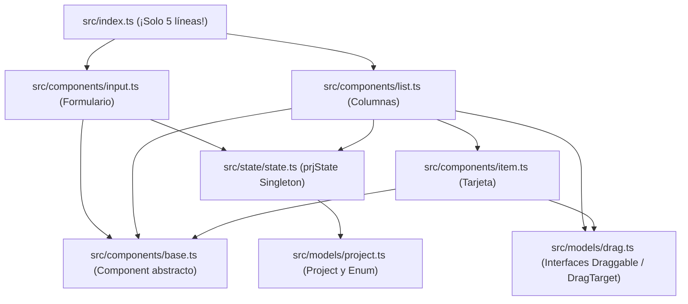

# 📘 Guía de Estudio — Capítulo 9: Mejorando el Proyecto con Módulos ES6 y Webpack

¡Buenas noticias! En el **Capítulo 9** ([`LIBRO-REACT-2023.md`](../LIBRO-REACT-2023.md#L2613-L3024)) **no hay ninguna lógica nueva ni conceptos difíciles**.

Todo lo que hace este capítulo es tomar el archivo gigante `src/index.ts` del Capítulo 8 (que tenía casi 300 líneas juntas) y **dividirlo en archivos pequeños y ordenados**, exactamente como se trabaja en proyectos profesionales y en React.

---

## 1. De 1 Archivo Gigante a 7 Archivos Pequeños (Módulos ES6)

En lugar de tener todo revuelto en un solo archivo, el Capítulo 9 separa cada pieza en su propia carpeta usando `export` (para compartir) e `import` (para usar):



### Mapa de Archivos de `chapter09/drag-drop/src/`

| Archivo | ¿Qué contiene adentro? | ¿Cuántas líneas tiene? |
| :--- | :--- | :---: |
| [`src/models/drag.ts`](./drag-drop/src/models/drag.ts) | Solo las 2 interfaces: `Draggable` y `DragTarget`. | ~12 líneas |
| [`src/models/project.ts`](./drag-drop/src/models/project.ts) | Solo el `enum ProjectStatus` y la `class Project`. | ~15 líneas |
| [`src/state/state.ts`](./drag-drop/src/state/state.ts) | La clase `State` y exporta `prjState`. | ~45 líneas |
| [`src/components/base.ts`](./drag-drop/src/components/base.ts) | La clase base `abstract class Component`. | ~30 líneas |
| [`src/components/item.ts`](./drag-drop/src/components/item.ts) | La clase `Item` (cada tarjeta). | ~40 líneas |
| [`src/components/list.ts`](./drag-drop/src/components/list.ts) | La clase `List` (las columnas Active/Finished). | ~65 líneas |
| [`src/components/input.ts`](./drag-drop/src/components/input.ts) | La clase `Input` (el formulario). | ~40 líneas |
| [`src/index.ts`](./drag-drop/src/index.ts) | **¡Solo importa `Input` y `List` y arranca la app!** | **5 líneas** |

---

## 2. ¿Cómo funcionan `export` e `import`?

Es igual que en React:

1. **Cuando quieres que algo se pueda usar en otro archivo, le pones `export` delante:**
   ```typescript
   // En src/models/project.ts
   export enum ProjectStatus { Active, Finished }
   export class Project { ... }
   ```
2. **Cuando otro archivo lo necesita, lo pide con `import`:**
   ```typescript
   // En src/state/state.ts
   import { Project, ProjectStatus } from '../models/project';
   ```
3. **`export default` (Exportación principal de un archivo):**
   - En `src/components/base.ts` solo hay 1 cosa principal (`Component`), así que usa `export default abstract class Component`.
   - Al importarlo no necesita llaves `{}`: `import Component from './base';`.

---

## 3. ¿Para qué entra Webpack en la segunda mitad del Capítulo 9?

### El problema de tener muchos archivos `.ts`:
Cuando divides tu código en 8 archivos `.ts` y usas solo `tsc`:
- El navegador tiene que hacer **8 descargas separadas** por internet (`index.js`, `input.js`, `list.js`, `item.js`, `base.js`, `state.js`, `project.js`, `drag.js`).
- Si un proyecto real tiene 500 archivos, el navegador se vuelve lento descargando 500 archivos uno por uno.

### La solución: Un "Empaquetador" (Bundler = Webpack)
**Webpack** lee tu `src/index.ts`, sigue todos los `import`, traduce todo el TypeScript a JavaScript y **funde los 8 archivos en un único archivo final súper rápido** llamado `dist/bundle.js`.

- **Tú programas cómodo** en 8 archivos chiquitos y ordenados dentro de `src/`.
- **El navegador descarga 1 solo archivo** (`dist/bundle.js`).
- *(Nota: En proyectos modernos como el que hicimos en el Capítulo 7 con Next.js, Next.js ya trae Webpack/Turbopack por dentro automáticamente sin que tú tengas que configurarlo a mano).*

---

## 4. Cómo ejecutar

Requisitos: Node.js 18+ y pnpm (o npm).

```bash
cd chapter09/drag-drop
pnpm install     # respeta pnpm-lock.yaml
pnpm build       # webpack + ts-loader -> dist/bundle.js
npx serve .      # sirve la carpeta; abre http://localhost:3000
```

- [`webpack.config.js`](./drag-drop/webpack.config.js) usa `mode: 'development'` (suficiente para el libro), `ts-loader` y genera `dist/bundle.js`.
- [`index.html`](./drag-drop/index.html) carga `<script src="dist/bundle.js"></script>`, por eso hay que servirlo desde la raíz del proyecto.
- Alternativa con recarga automática: `pnpm dev` (ejecuta `webpack serve` en `http://localhost:8080`).
- Abrir `index.html` directamente con doble clic **no** funciona aquí: el bundle usa módulos internos de Webpack y necesita servirse por HTTP.
