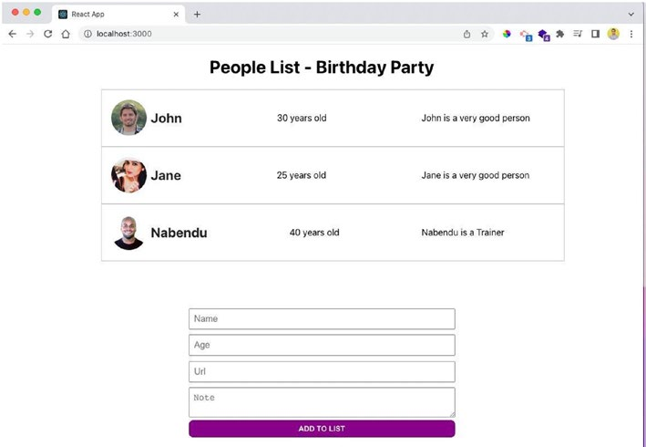
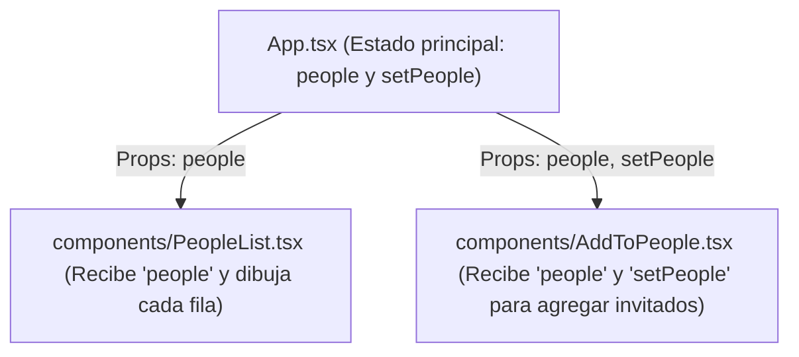

# 📘 Guía de Estudio — Capítulo 10: Party App en ReactJS con TypeScript

El **Capítulo 10** ([`LIBRO-REACT-2023.md`](../LIBRO-REACT-2023.md#L3025-L3299)) es un proyecto independiente y completo donde el profesor enseña cómo usar **TypeScript dentro de React**.

El proyecto se llama **Party App ("People List - Birthday Party")**: muestra una lista de invitados con su foto, nombre, edad y nota arriba, y un formulario abajo para agregar nuevos invitados.



---

## 1. Arquitectura de la Aplicación (3 Componentes)



Cada invitado es un objeto con **4 propiedades**:
- `name`: `string` (Nombre)
- `age`: `number` (Edad)
- `img`: `string` (URL de la foto)
- `note`: `string` (Nota sobre la persona)

---

## 2. Los 4 Conceptos de TypeScript en React que Enseña el Capítulo

| # | Parte de React | ¿Cómo se tipa en TypeScript? | Dónde se usa |
| :-: | :--- | :--- | :--- |
| **1** | **Estado (`useState`)** | `useState<{ name: string; age: number; img: string; note: string }[]>([...])` | `App.tsx` (*Listing 10-1*) |
| **2** | **Props de Componente** | `interface IProps { people: { ... }[] }` + `React.FC<IProps>` | `PeopleList.tsx` (*Listing 10-3*) |
| **3** | **Evento `onChange`** | `e: React.ChangeEvent<HTMLInputElement \| HTMLTextAreaElement>` | `AddToPeople.tsx` (*Listing 10-5*) |
| **4** | **Pasar `setState` por Props** | `React.Dispatch<React.SetStateAction<{ ... }[]>>` | `AddToPeople.tsx` (*Listing 10-8*) |

---

## 3. Código Explicado Paso a Paso

### Paso 1: Estado Principal en `App.tsx` (*Listings 10-1, 10-2 y 10-7*)

```tsx
import { useState } from 'react';
import './App.css';
import PeopleList from './components/PeopleList';
import AddToPeople from './components/AddToPeople';

function App() {
  const [people, setPeople] = useState<{
    name: string;
    age: number;
    img: string;
    note: string;
  }[]>([
    {
      name: 'John',
      age: 30,
      img: 'https://randomuser.me/api/portraits/men/22.jpg',
      note: 'John is a very good person'
    },
    {
      name: 'Jane',
      age: 25,
      img: 'https://randomuser.me/api/portraits/women/22.jpg',
      note: 'Jane is a very good person'
    }
  ]);

  return (
    <div className="App">
      <h1>People List - Birthday Party</h1>
      <PeopleList people={people} />
      <AddToPeople people={people} setPeople={setPeople} />
    </div>
  );
}

export default App;
```

---

### Paso 2: Mostrar la Lista en `PeopleList.tsx` (*Listing 10-3*)

Usa `interface IProps` para declarar qué recibe del padre (`App`) y `React.FC<IProps>` (*Functional Component*):

```tsx
import React from 'react';

interface IProps {
  people: {
    name: string;
    age: number;
    img: string;
    note: string;
  }[];
}

const PeopleList: React.FC<IProps> = ({ people }) => {
  return (
    <ul>
      {people.map((person, index) => (
        <li key={index} className="list">
          <div className="list-header">
            
            <h2>{person.name}</h2>
          </div>
          <p>{person.age} years old</p>
          <p className="list-note">{person.note}</p>
        </li>
      ))}
    </ul>
  );
};

export default PeopleList;
```

---

### Paso 3: Formulario para Agregar Invitados en `AddToPeople.tsx` (*Listings 10-5, 10-8 y 10-9*)

1. **Un solo `handleChange`** maneja tanto los `<input>` como el `<textarea>` gracias al Union Type `HTMLInputElement | HTMLTextAreaElement`.
2. **Tipado de `setPeople`:** En VS Code, al pasar el mouse sobre `setPeople` en `App.tsx`, TypeScript muestra su tipo exacto: `React.Dispatch<React.SetStateAction<...>>`.
3. **Conversión de edad:** Como los `<input>` siempre guardan texto (`string`), al guardar en `people` se convierte la edad a número con `Number(input.age)`.

```tsx
import React, { useState } from 'react';

interface IProps {
  people: {
    name: string;
    age: number;
    img: string;
    note: string;
  }[];
  setPeople: React.Dispatch<
    React.SetStateAction<
      {
        name: string;
        age: number;
        img: string;
        note: string;
      }[]
    >
  >;
}

const AddToPeople: React.FC<IProps> = ({ setPeople, people }) => {
  const [input, setInput] = useState({ name: '', age: '', note: '', img: '' });

  const handleChange = (
    e: React.ChangeEvent<HTMLInputElement | HTMLTextAreaElement>
  ) => {
    setInput({
      ...input,
      [e.target.name]: e.target.value
    });
  };

  const handleClick = () => {
    if (!input.name || !input.age || !input.img || !input.note) return;

    setPeople([
      ...people,
      {
        name: input.name,
        age: Number(input.age),
        img: input.img,
        note: input.note
      }
    ]);

    setInput({ name: '', age: '', note: '', img: '' });
  };

  return (
    <div className="add-people">
      <input
        type="text"
        onChange={handleChange}
        className="add-input"
        name="name"
        value={input.name}
        placeholder="Name"
      />
      <input
        type="text"
        onChange={handleChange}
        className="add-input"
        name="age"
        value={input.age}
        placeholder="Age"
      />
      <input
        type="text"
        onChange={handleChange}
        className="add-input"
        name="img"
        value={input.img}
        placeholder="Url"
      />
      <textarea
        onChange={handleChange}
        className="add-input"
        name="note"
        value={input.note}
        placeholder="Note"
      />
      <button onClick={handleClick} className="add-button">
        Add to List
      </button>
    </div>
  );
};

export default AddToPeople;
```

> **Nota de implementación:** el proyecto usa la firma moderna `const Component = ({ ... }: IProps) => ...` en lugar de `React.FC<IProps>`. El tipado de props y eventos es equivalente; además, el tipo `Person` se comparte desde `src/types/person.ts` para evitar duplicar la interfaz en cada componente.

---

## 4. Estado del Proyecto

✅ **Completado** — implementado en `chapter10/party-app/` y verificado con `npm run build`.

### Estructura final

```text
chapter10/
├── readme.md
└── party-app/
    ├── index.html
    ├── package.json
    ├── tsconfig.json
    ├── vite.config.ts
    └── src/
        ├── main.tsx
        ├── App.tsx
        ├── App.css
        ├── types/
        │   └── person.ts
        └── components/
            ├── PeopleList.tsx
            └── AddToPeople.tsx
```

### Comandos

```bash
cd chapter10/party-app
npm install
npm run dev     # servidor de desarrollo
npm run build   # type-check + build de producción en dist/
```
