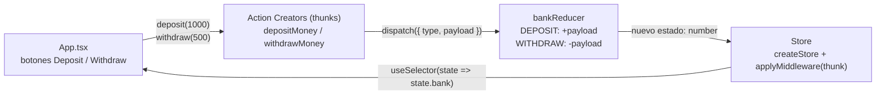

# 📘 Capítulo 11 — Usando React Redux con TypeScript

El **Capítulo 11** ([`LIBRO-REACT-2023.md`](../LIBRO-REACT-2023.md#L3300-L3502)) cierra el libro con una app muy pequeña pero completa: un **cajero/banco** que muestra un saldo y permite **depositar 1000** o **retirar 500** mediante botones. El objetivo no es la interfaz, sino aprender a **tipar un flujo Redux clásico** (sin Redux Toolkit): acciones, reducer, store, thunks y hooks de `react-redux`.


Proyecto implementado en [`redux-app/`](./redux-app) con **Vite + React 18 + TypeScript + Redux 4**.

---

## 1. Flujo Redux de la aplicación



1. El usuario pulsa **Deposit** o **Withdraw**.
2. `App.tsx` llama al creador de acciones (`depositMoney(1000)`, `withdrawMoney(500)`), que es un **thunk**: una función que recibe `dispatch`.
3. El thunk despacha una acción plana `{ type: ActionType.DEPOSIT | WITHDRAW, payload: number }`.
4. `bankReducer` recibe el estado actual (`number`) y la acción, y devuelve el nuevo saldo (`state + payload` o `state - payload`).
5. El store notifica el cambio; `useSelector` vuelve a leer `state.bank` y React re-renderiza el `<h1>` con el saldo.

### ¿Por qué hay thunks si las acciones son sincrónicas?

En este ejemplo el thunk es redundante (podría despacharse la acción directamente). El libro lo usa para **practicar el tipado de `Dispatch` y del middleware** `redux-thunk`, que es lo que se necesita cuando una acción hace trabajo asíncrono. Se conserva el diseño del libro, pero con tipos correctos.

---

## 2. Mapa de archivos

```
chapter11/
├── readme.md                      ← este documento
└── redux-app/
    ├── index.html                 ← div#root + /src/main.tsx
    ├── package.json               ← scripts dev / build / preview
    ├── tsconfig.json              ← strict, jsx react-jsx, moduleResolution bundler, noEmit
    ├── vite.config.ts             ← plugin React
    └── src/
        ├── main.tsx               ← StrictMode > Provider > App
        ├── App.tsx                ← useSelector + useDispatch + botones
        ├── App.css                ← tarjeta centrada y botones
        ├── index.css              ← reset y centrado global
        ├── vite-env.d.ts          ← tipos de Vite
        └── state/
            ├── index.ts           ← barrel: export * from store y creators
            ├── store.ts           ← createStore + applyMiddleware(thunk) + AppDispatch
            ├── types/index.ts     ← enum ActionType { DEPOSIT, WITHDRAW }
            ├── actions/index.ts   ← DepositAction, WithdrawAction, Action
            ├── reducers/
            │   ├── bankReducer.ts ← lógica del saldo (switch)
            │   └── index.ts       ← combineReducers + RootState
            └── creators/index.ts  ← depositMoney, withdrawMoney (thunks)
```

### Piezas clave

| Archivo | Responsabilidad | Tipo importante |
| :--- | :--- | :--- |
| `state/types/index.ts` | Identificadores de acción | `enum ActionType` |
| `state/actions/index.ts` | Forma de las acciones | `Action = DepositAction \| WithdrawAction` |
| `state/reducers/bankReducer.ts` | Calcula el nuevo saldo | `(state: number, action: Action) => number` |
| `state/reducers/index.ts` | Combina reducers y expone el estado global | `RootState = ReturnType<typeof reducers>` |
| `state/creators/index.ts` | Thunks que despachan acciones | `BankThunk = (dispatch: Dispatch<Action>) => void` |
| `state/store.ts` | Crea el store con middleware | `AppDispatch = typeof store.dispatch` |
| `App.tsx` | Conecta React con Redux | `useSelector`, `useDispatch<AppDispatch>` |

`RootState` se deriva del propio reducer con `ReturnType`, así que si mañana se añade otro reducer (por ejemplo `user`), el tipo se actualiza solo y `state.bank` sigue estando tipado.

---

## 3. Código esencial

### 3.1 Tipos y acciones

```typescript
// state/types/index.ts
export enum ActionType {
  DEPOSIT = "DEPOSIT",
  WITHDRAW = "WITHDRAW",
}
```

```typescript
// state/actions/index.ts
import { ActionType } from "../types";

export interface DepositAction {
  type: ActionType.DEPOSIT;
  payload: number;
}

export interface WithdrawAction {
  type: ActionType.WITHDRAW;
  payload: number;
}

export type Action = DepositAction | WithdrawAction;
```

La **unión discriminada** permite que, dentro de cada `case` del reducer, TypeScript sepa exactamente qué acción hay y que `payload` es un `number`.

### 3.2 Reducer

```typescript
const bankReducer = (state: number = 0, action: Action): number => {
  switch (action.type) {
    case ActionType.DEPOSIT:
      return state + action.payload;
    case ActionType.WITHDRAW:
      return state - action.payload;
    default:
      return state;
  }
};
```

### 3.3 Thunks tipados

```typescript
import type { Dispatch } from "redux";
import type { Action } from "../actions";
import { ActionType } from "../types";

export type BankThunk = (dispatch: Dispatch<Action>) => void;

export const depositMoney = (amount: number): BankThunk => {
  return (dispatch: Dispatch<Action>) => {
    dispatch({ type: ActionType.DEPOSIT, payload: amount });
  };
};
```

### 3.4 Store

```typescript
import { applyMiddleware, createStore } from "redux";
import thunk, { type ThunkDispatch } from "redux-thunk";
import type { Action } from "./actions";
import reducers, { type RootState } from "./reducers";

// redux-thunk 2.x es compatible con redux 4 y usa export default.
const middleware = applyMiddleware(thunk);

export const store = createStore(reducers, middleware);
export type AppDispatch = ThunkDispatch<RootState, unknown, Action>;
```

### 3.5 Componente

```tsx
const amount = useSelector((state: RootState) => state.bank);
const dispatch = useDispatch<AppDispatch>();

const deposit = (value: number) => dispatch(depositMoney(value));
const withdraw = (value: number) => dispatch(withdrawMoney(value));

return (
  <div className="App">
    <h1 className="balance">{amount}</h1>
    <button className="btn deposit" onClick={() => deposit(1000)}>Deposit</button>
    <button className="btn withdraw" onClick={() => withdraw(500)}>Withdraw</button>
  </div>
);
```

Se evita `bindActionCreators(actionCreators, dispatch)` (como propone el libro) porque obliga a tipar a mano el resultado y pierde inferencia. Con `useDispatch<AppDispatch>()` y dos funciones envoltorio se obtiene lo mismo con tipos exactos y sin `any`.

---

## 4. Erratas del libro corregidas

| # | Libro (Listing) | Problema | Corrección aplicada |
| :-: | :--- | :--- | :--- |
| 1 | 11-6 | `import { Dispatch } from "react"` | `import type { Dispatch } from "redux"`. `Dispatch` es un tipo del store, no de React; importarlo de `react` no existe y rompe la compilación. |
| 2 | 11-4 | `npm i redux react-redux react-thunk @types/react-redux` | El paquete correcto es **`redux-thunk`** (no `react-thunk`). Se usa `redux-thunk@2.4.2` + `@types/redux-thunk`, compatibles con Redux 4 y con el `import thunk from "redux-thunk"` del libro. |
| 3 | 11-7 | `const store = createStore(reducers, {}, applyMiddleware(thunk))` | El segundo argumento `{}` no es un estado válido (`RootState` es `{ bank: number }`). Se usa la sobrecarga `createStore(reducer, enhancer)`. |
| 4 | 11-11 | `bindActionCreators(actionCreators, dispatch)` sin genéricos | Se sustituye por `useDispatch<AppDispatch>()` + envoltorios `deposit`/`withdraw`. Tipado completo y sin `any`. |
| 5 | 11-11 | `useDispatch()` sin tipo | En Redux moderno `useDispatch()` devuelve `Dispatch<UnknownAction>` y **no acepta thunks**. Con `AppDispatch` (= `ThunkDispatch<RootState, unknown, Action>`) sí se despachan funciones. |
| 6 | 11-11 | `depositMoney(1000)` se llama directamente en `onClick` | Se envuelve en `() => deposit(1000)`; así el handler devuelve `void` y no se pasa el evento como argumento. |
| 7 | 11-9 | `ReactDOM.createRoot` y `document.getElementById(...) as HTMLElement` | Se usa `createRoot` de `react-dom/client` y se mantiene el `as HTMLElement` (o se podría comprobar el nulo). Se añade `StrictMode`. |
| 8 | 11-7 | Falta instalar los tipos de thunk | Se instala `@types/redux-thunk@2.1.32`, que corresponde a la versión 2.x del middleware. |

> **Nota sobre `@types/react-redux`:** `react-redux@8` ya incluye sus propios tipos. El paquete `@types/react-redux@7` se instala porque lo pide el capítulo y sirve como respaldo para editores, pero no es necesario para compilar.

---

## 5. Comandos

Desde `chapter11/redux-app/`:

```bash
npm install     # instala dependencias
npm run dev     # servidor de desarrollo (http://localhost:5173)
npm run build   # tsc --noEmit && vite build → genera dist/
npm run preview # sirve la build de producción
```

### Nota de versiones

El libro usa **Redux 4**. Por eso el proyecto fija `redux-thunk@2.4.2`, cuya peer dependency es `redux@^4`, en lugar de `redux-thunk@3` (que exige Redux 5 y provoca `ERESOLVE`). Con esta combinación `npm install` funciona sin `--legacy-peer-deps` y el `import thunk from "redux-thunk"` del libro es válido.

Si en el futuro se migra a Redux 5, habría que usar `redux-thunk@3` (export nombrado `thunk`) y revisar `createStore`, que en Redux 5 está deprecado en favor de `configureStore`/`legacy_createStore`.

---

## 6. Salida esperada

Al abrir `http://localhost:5173` se ve una tarjeta centrada:

- Saldo inicial: **0** en un `<h1>` grande.
- Botón verde **Deposit** → suma **1000** por clic.
- Botón rojo **Withdraw** → resta **500** por clic.
- El saldo puede quedar negativo (no hay validación, igual que en el libro).

Secuencia de ejemplo:

| Clic | Acción despachada | Saldo |
| :--- | :--- | ---: |
| — | estado inicial | 0 |
| Deposit | `{ type: "DEPOSIT", payload: 1000 }` | 1000 |
| Deposit | `{ type: "DEPOSIT", payload: 1000 }` | 2000 |
| Withdraw | `{ type: "WITHDRAW", payload: 500 }` | 1500 |
| Withdraw | `{ type: "WITHDRAW", payload: 500 }` | 1000 |

### Verificación realizada

```text
$ npm install
added 82 packages, and audited 83 packages in 8s
found 0 vulnerabilities

$ npm run build
> tsc --noEmit && vite build
vite v6.4.5 building for production...
✓ 92 modules transformed.
dist/index.html                   0.41 kB
dist/assets/index-B-2ErDt7.css    1.29 kB
dist/assets/index-B_FSLf1Q.js   159.98 kB │ gzip: 51.68 kB
✓ built in 904ms
```

La comprobación de tipos (`tsc --noEmit`) pasa en modo `strict`, sin `any` y sin `@ts-ignore`.

---

## 7. Ideas para practicar

1. Añade un botón **Reset** con una nueva acción `RESET` (`payload` inexistente) y observa cómo la unión discriminada obliga a actualizar el reducer.
2. Añade un segundo reducer (`history`) que guarde un array de operaciones y comprueba que `RootState` se amplía automáticamente.
3. Convierte el saldo en `{ amount: number; currency: string }` para practicar tipos de objeto en lugar de `number`.
4. Sustituye los thunks por `dispatch` directo y compara: menos código, pero se pierde la práctica del middleware.
5. Implementa una versión con Redux Toolkit (`createSlice`, `configureStore`) y compara cuánto código se ahorra.
